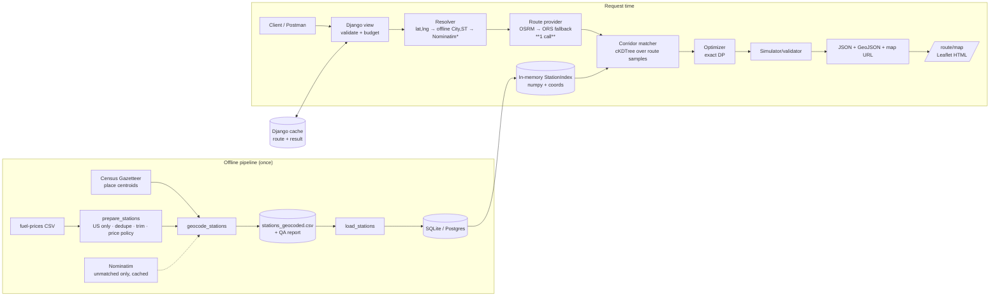
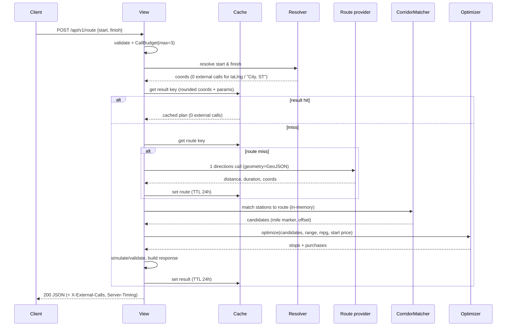

# FuelRoute API — Architecture

> Companion to `SCOPE.md`. Every decision ID (D1…D13) refers to that document.

## 1. System overview

Two clearly separated worlds:

- **Offline (build time, run once):** turn the raw CSV into a clean, geocoded station dataset committed to the repo. No network needed at runtime for this.
- **Online (request time):** resolve two endpoints → **one** routing call → pure in-memory geometry + optimization → JSON/HTML. Fast because all fuel data is already in RAM.


`*` Nominatim only for free-text addresses; typical request makes exactly one external call.

## 2. Technology choices

| Concern | Choice | Why |
|---|---|---|
| Language | Python **3.13** (3.12–3.14 supported by Django 6.1) | Latest stable, fast |
| Framework | **Django 6.1.x** (verify on PyPI at build time; use latest patch) | Brief requires latest stable |
| HTTP layer | **Plain Django views** + hand-written validators; `JsonResponse` | Avoids DRF/Django-6.1 compatibility risk; lowest overhead |
| Numerics | `numpy`, `scipy` (`cKDTree` only) | Vectorized DP + fast nearest-neighbour |
| HTTP client | `httpx` (sync, pooled `Client`, timeouts) | Modern, testable via `respx` |
| DB | SQLite by default; settings ready for Postgres via `DATABASE_URL` | Zero-setup for reviewers |
| Cache | Django cache: `LocMemCache` default, Redis optional via `REDIS_URL` | No infra needed |
| Server | `gunicorn` (gthread) in Docker; `runserver` in dev | Standard |
| Tooling | `uv` (or pip), `ruff`, `pytest`, `pytest-django`, `respx`, `hypothesis`, `coverage` | Fast & standard |
| Map | Leaflet + OSM tiles (client side) | Free, keyless |
| CI | GitHub Actions: ruff + pytest + coverage | Reviewer confidence |

## 3. Repository layout

```
fuelroute/
├── AGENTS.md                      # agent rules + build prompts
├── README.md
├── pyproject.toml                 # deps pinned; django>=6.1,<6.2
├── Makefile  Dockerfile  .env.example  .gitignore  .dockerignore
├── .github/workflows/ci.yml
├── manage.py
├── config/                        # settings.py (env-driven), urls.py, wsgi.py, asgi.py
├── apps/
│   ├── stations/
│   │   ├── models.py              # FuelStation
│   │   ├── index.py               # StationIndex (in-memory, thread-safe singleton)
│   │   ├── pricing.py             # price policy (min|median|mean)
│   │   └── management/commands/   # prepare_stations, geocode_stations, load_stations
│   ├── geo/
│   │   ├── distance.py            # haversine, unit-vector, chord<->miles
│   │   ├── resample.py            # cumulative distance, fixed-step resampling, simplify
│   │   ├── corridor.py            # CorridorMatcher (KD-tree)
│   │   └── gazetteer.py           # place-name normalization + lookup
│   ├── providers/
│   │   ├── base.py                # Protocols + dataclasses (RouteResult, GeocodeResult)
│   │   ├── osrm.py  ors.py  nominatim.py  fixture.py
│   │   ├── budget.py              # CallBudget (max 3) + call log
│   │   └── errors.py              # typed exceptions → API error codes
│   ├── planner/
│   │   ├── optimizer.py           # exact DP (pure function, no Django imports)
│   │   ├── simulate.py            # independent plan validator
│   │   ├── service.py             # orchestration: resolve→route→corridor→optimize→simulate
│   │   └── schemas.py             # dataclasses for Plan, Stop, Totals
│   └── api/
│       ├── views.py  urls.py  validators.py  errors.py  middleware.py
│       ├── templates/api/map.html
│       └── openapi.yaml
├── data/
│   ├── raw/fuel-prices-for-be-assessment.csv
│   ├── gazetteer/                 # downloaded Census files (gitignored if large; checksum recorded)
│   ├── stations_clean.csv
│   ├── stations_geocoded.csv      # COMMITTED runtime artifact
│   ├── geocode_cache.json         # Nominatim results, committed
│   └── geocode_report.md          # QA report
├── tests/{unit,integration,property,fixtures}/
├── scripts/{bench.py,record_fixtures.py}
└── docs/{SCOPE.md,ARCHITECTURE.md,LOOM_SCRIPT.md,postman/fuelroute.postman_collection.json}
```
Rule: `planner/optimizer.py`, `geo/*` are **pure Python/numpy with no Django imports** → trivially unit-testable and reusable.

## 4. Offline data pipeline

### 4.1 `prepare_stations` (raw → `stations_clean.csv`)
1. Read CSV with `dtype=str`, then cast. Strip + collapse whitespace on all text columns; state → upper.
2. Drop non-US rows: `State ∉ {AL … WY}` (use an explicit set of 50 states + DC; Canadian province codes rejected).
3. Drop exact duplicate rows.
4. Group by `OPIS Truckstop ID`:
   - `price` = policy (`min` default, D3) over the group's `Retail Price`; also store `price_min`, `price_max`, `n_price_rows`.
   - `name` = longest non-empty name (deterministic tie-break: alphabetical).
   - `address`, `city`, `state`, `rack_id` = first (verified constant per ID in the audit; assert it).
5. Validate: price in `[1.5, 10]` else exclude + report; flag prices > mean + 4σ as `price_outlier=True` (kept).
6. Write `stations_clean.csv` (expected ≈ **6,626 rows**; assert within ±0).

### 4.2 `geocode_stations` (clean → `stations_geocoded.csv`)
Tiered matching, each row records `geocode_method` and `geocode_confidence`:

| Tier | Method | Notes |
|---|---|---|
| 1 | **Census Gazetteer place** exact match on normalized `(name, state)` | Files: latest `*_Gaz_place_national` (places incl. CDPs). Strip suffixes ` city`, ` town`, ` village`, ` borough`, ` CDP`, ` municipality`. Discover the latest year from the Census directory listing — **do not hardcode blindly** |
| 2 | **Gazetteer county-subdivision** exact match | Covers townships/towns (MI, PA, NJ, New England) |
| 3 | Normalized fuzzy match within same state (`St.`↔`Saint`, `Ft.`↔`Fort`, `Mt.`↔`Mount`, drop punctuation, `&`→`and`) using `rapidfuzz` ratio ≥ 94 | Log every fuzzy match in the report |
| 4 | **Nominatim** structured query `city, state, USA` — **only for still-unmatched unique (city,state)**, 1 req/s, custom `User-Agent`, results cached in `geocode_cache.json` | One-time; never at runtime |
| — | Still unmatched | **Excluded** and listed in `geocode_report.md` |

Gate: **≥ 98 %** of clean stations geocoded, all coordinates inside US bounds (lat 24.3–49.5, lng −125.1 to −66.8), else the command exits non-zero.
Expected size of the Nominatim tier: a few dozen to a few hundred unique places.

`geocode_report.md` must include: counts per tier, list of fuzzy matches, list of Nominatim matches, list of excluded stations, per-state coverage, price stats, dedupe stats.

### 4.3 `load_stations`
Idempotent upsert into `FuelStation` (`opis_id` unique). Wrapped in a transaction; prints counts.

```
FuelStation(
  opis_id: int (unique, indexed), name, address, city, state(2), rack_id: int,
  price: Decimal(6,4), price_min, price_max, n_price_rows,
  lat: float, lng: float, geocode_method, geocode_confidence, price_outlier: bool
)
```

## 5. Runtime request flow



Cache keys: `route:v1:{lat1:.4f},{lng1:.4f}:{lat2:.4f},{lng2:.4f}` and `plan:v1:{route key}:{range}:{mpg}:{start_mode}:{data_version}`. `data_version` = hash of `stations_geocoded.csv` so cache self-invalidates when data changes.

## 6. Module specifications

### 6.1 `geo/distance.py`
- `haversine_miles(lat1, lng1, lat2, lng2)` (R = 3958.7613 mi), vectorized.
- `to_unit_vectors(lat, lng) -> (N,3)` for KD-tree in 3-D (avoids projection/antimeridian issues).
- `miles_to_chord(m)` / `chord_to_miles(c)` : `chord = 2·sin(θ/2)`, `θ = m / R`.

### 6.2 `geo/resample.py`
- `cumulative_miles(coords)` → array of cumulative haversine miles.
- `scale_to_provider(cum, provider_distance_miles)` → multiplies so `cum[-1] == provider distance` (provider road distance is authoritative).
- `resample(coords, step_miles=0.5)` → evenly spaced samples using `np.interp` on lat/lng vs cumulative distance (safe at 0.5 mi steps). Returns `(lat, lng, mile_marker)`.
- `simplify_for_response(coords, max_points=1500)` → Douglas-Peucker (or uniform stride retaining endpoints) for payload size.

### 6.3 `geo/corridor.py` — `CorridorMatcher`
```
match(route_samples, index, buffer_miles) -> CandidateSet
  tree = cKDTree(unit_vectors(route_samples))          # ~9k pts for a 4.5k-mi route
  d, j = tree.query(index.unit_vectors, distance_upper_bound=miles_to_chord(buffer))
  keep = isfinite(d)
  offset_miles = chord_to_miles(d[keep])
  mile_marker  = route_samples.mile[j[keep]]
```
Returns arrays: `station_idx, mile_marker, offset_miles`. Complexity ≈ O(S log R) with S = 6.6 k → a few ms.

### 6.4 `stations/index.py` — `StationIndex`
Loaded once per process from the DB (lazy, guarded by a lock): numpy arrays `opis_id, lat, lng, price, unit_vectors`, plus a list/array of metadata for response building. Exposes `data_version`. `apps.py::ready()` triggers a warm load (skipped for management commands like `migrate`).

### 6.5 `providers/*`
```
class RouteProvider(Protocol):
    name: str
    def route(self, start: LatLng, finish: LatLng, budget: CallBudget) -> RouteResult
class Geocoder(Protocol):
    def geocode(self, text: str, budget: CallBudget) -> GeocodeResult
```
- **OSRM** (default): `GET {OSRM_BASE_URL}/route/v1/driving/{lng1},{lat1};{lng2},{lat2}?overview=full&geometries=geojson&steps=false&alternatives=false`. Default base `https://router.project-osrm.org`. Parse `routes[0].distance` (m), `.duration` (s), `.geometry.coordinates`. Non-`Ok` code (`NoRoute`) → `NoRouteError`.
- **ORS** (fallback, needs `ORS_API_KEY`): `POST https://api.openrouteservice.org/v2/directions/driving-car/geojson` with `{"coordinates": [[lng,lat],[lng,lat]]}`; header `Authorization: <key>`. Map 403/429 to `UpstreamError` (not retried).
- **Nominatim**: `GET /search?q=…&format=jsonv2&countrycodes=us&limit=1` with real `User-Agent`; only for free-text.
- **Fixture** (`ROUTING_PROVIDER=fixture`): serves recorded JSON from `tests/fixtures/` — used in tests, CI, and offline demos.
- **Policy:** timeout 8 s (connect 3 s), 1 retry on timeout/5xx with 200 ms backoff for the *same* provider **only if budget remains**; then fallback provider if configured. Every HTTP attempt calls `budget.consume(provider, purpose)`; exceeding 3 raises `BudgetExceeded` → 502. Attempts are logged into `meta.external_calls_detail`.

### 6.6 `planner/service.py`
`plan_trip(start_text_or_coords, finish_text_or_coords, params) -> TripPlan`:
1. Resolve endpoints (validators → resolver).
2. Result-cache lookup; else route-cache lookup; else `provider.route`.
3. `samples = resample(scale_to_provider(...), 0.5)`.
4. For `buffer in (10, 25, 50)`: candidates = matcher.match(...); `plan = optimize(...)`; break on feasible. Add `warnings` if widened.
5. Simulate → assert valid (raise `InternalError` if not; this must never fire in prod).
6. Assemble `TripPlan` (dataclasses), timings, cache metadata.

## 7. Optimizer — exact algorithm

**Model.** Units are whole miles of range. Tank capacity `G = floor(max_range_miles − 1)` (the 1-mile margin absorbs integer rounding; default 499). Price per unit for station *i*: `c_i = price_i / mpg` (dollars per mile of range).

**Inputs.** Candidate list sorted by `(M_i, price_i, opis_id)` where `M_i = round(mile_marker_i)`; `k_i = ceil(DETOUR_FACTOR · offset_i)` (miles burned leaving/returning to the route); destination `M_D = round(route_miles)`. Skip candidates with `k_i > G` or `M_i` outside `[0, M_D]`.

**Start node.** `START_MODE=priced`: virtual station at `M=0`, `k=0`, price `p0` (median price of candidates with `M ≤ 100`, else national median), initial `f[g] = g·c0` for `g = 0..G`. `START_MODE=free`: `f[G] = 0`, else ∞.

**DP state.** `f[g]` = minimum dollars spent so far to be at the current route position with exactly `g` units of fuel.

```python
INF = np.inf; idx = np.arange(G + 1); EPS = 1e-4   # per-visit tie-break: prefer fewer stops
pos = 0
hist = []                                          # per station: (visit_mask, argmin_index, k, L)

for s in candidates:
    L = s.M - pos                                  # integer leg
    f = shift_down(f, L)                           # f_new[g-L] = f[g]; entries with g<L drop; top filled INF
    pos = s.M
    fd = shift_down(f, s.k)                        # fuel after detour burn
    c  = s.price / mpg
    A  = fd - idx * c
    pm = np.minimum.accumulate(A)                  # best (fd[g]-g*c) over g <= g'
    arg = np.maximum.accumulate(np.where(A == pm, idx, 0))   # index of that minimum
    h  = idx * c + pm + EPS                        # buy (g'-g) units at c after arriving with g
    visit = h < f
    f  = np.where(visit, h, f)
    hist.append((visit, arg, s.k, L))

L = M_D - pos
f = shift_down(f, L)
g_end = int(np.argmin(f))                          # arrive with >= 0 fuel; leftover is wasted money so optimum is 0
cost = f[g_end]                                    # INF => infeasible at this corridor width
```

**Reconstruction (backwards).** Start with `g = g_end` after the final leg shift and walk `hist` in reverse:
`g += L_final`; then for each station from last to first: if `visit[g]`: `g_pre_detour = arg[g]` (fuel just after detour burn) → units bought `= g − arg[g]`, fuel on arrival at the route point `= arg[g] + k`; set `g = arg[g] + k`; then `g += L` (undo the leg). At the end the remaining `g` is the initial fuel at the start node (priced mode: buy `g` units at `p0`).
Every stop records: `units_bought → gallons = units / mpg`, price, cost.

**Optimality.** Continuous-purchase gas-station problem with fixed per-visit detour burn: the DP is exact on the 1-mile grid because prices are linear in fuel and the prefix-min formulation covers every "arrive with `g`, leave with `g'`" purchase. Complexity `O(n·G)` with n ≈ 100–1,500 candidates and G = 499 → tens of ms in numpy.

**Validation (independent of DP).** `simulate.py` replays the plan with **float** distances: fuel never < 0 or > tank; each leg ≤ `max_range`; totals recomputed with `Decimal`; compares to DP cost (tolerance $0.05 per stop for rounding). Raises on mismatch.

**Oracle (tests only).** For small instances (≤ 8 candidates), enumerate every subset of stops, solve purchase amounts with `scipy.optimize.linprog`, take the minimum → must equal DP cost (within 1e-6 × units).

**Baselines (tests only).** Greedy "next cheaper station within range else fill" and "fill at every stop" — DP cost ≤ both, always.

**Totals.**
`total_fuel_cost_usd = Σ round_half_up(gallons_i × price_i, 0.01)` (+ start fill in priced mode reported as `start_fill`).
`total_gallons = units_total / mpg`, and `|total_gallons × mpg − (route_miles + Σ detours)| ≤ 1`.

## 8. Performance design

| Step | Budget |
|---|---|
| Validation + resolve (offline) | < 2 ms |
| Upstream route call (uncontrollable) | 0.3–2 s typical; cached afterwards |
| Resample (0.5 mi, ≤ 10 k pts) | < 10 ms |
| KD-tree build + query 6.6 k stations | < 15 ms |
| DP (n ≤ 1,500, G = 499) | < 60 ms |
| Simulate + serialize (≤ 300 KB) | < 30 ms |

Other rules: no DB access on the request path (index is in RAM); one pooled `httpx.Client` per process; `JsonResponse` with `separators=(",", ":")`; default `geometry=simplified` (≤ 1,500 points); gzip via `GZipMiddleware`.

## 9. Configuration (env, all with safe defaults)

```
DJANGO_SECRET_KEY  DJANGO_DEBUG=False  DJANGO_ALLOWED_HOSTS=localhost,127.0.0.1
DATABASE_URL=sqlite:///db.sqlite3    REDIS_URL=(optional)
ROUTING_PROVIDER=osrm|ors|fixture    OSRM_BASE_URL=https://router.project-osrm.org
ORS_API_KEY=(optional)               NOMINATIM_BASE_URL=https://nominatim.openstreetmap.org
NOMINATIM_USER_AGENT=fuelroute-assessment/1.0 (contact: you@example.com)
MAX_RANGE_MILES=500  MPG=10  START_MODE=priced|free  STATION_PRICE_POLICY=min|median|mean
CORRIDOR_MILES=10,25,50  DETOUR_FACTOR=2.0  SAFETY_RESERVE_MILES=0
EXTERNAL_CALL_BUDGET=3  UPSTREAM_TIMEOUT_S=8  CACHE_TTL_S=86400  RATE_LIMIT_PER_MIN=60
```
`.env.example` committed; `.env` git-ignored. Settings parse and **validate** env at startup (fail fast on nonsense values).

## 10. Error handling & logging
- Domain exceptions (`ValidationFailed`, `LocationNotFound`, `OutsideUSA`, `SameLocation`, `NoRoute`, `NoFeasiblePlan`, `UpstreamError`, `UpstreamTimeout`, `BudgetExceeded`) map 1-to-1 to codes in SCOPE §6 via one exception handler in `api/errors.py`.
- Middleware assigns `request_id` (UUID4 or inbound `X-Request-ID`), sets `X-Request-ID`, `X-External-Calls`, `Server-Timing: total;dur=…, route;dur=…, optimize;dur=…`.
- JSON logs (stdlib `logging`): request_id, path, status, external_calls, timings, cache. Never log API keys.

## 11. Testing strategy

| Layer | What | Tools |
|---|---|---|
| Unit | haversine, resample, corridor, gazetteer normalization, price policy, validators, money rounding | pytest |
| Optimizer | oracle equivalence (≥ 200 random small instances), greedy/fill-every-stop dominance, infeasible detection, tie determinism | pytest + hypothesis |
| Simulator | fuel bounds, leg limits, cost recompute | pytest |
| Providers | success, `NoRoute`, timeout→retry→fallback, budget exhaustion, malformed JSON | respx |
| Integration | full endpoint w/ fixture provider: Chicago→Dallas, NYC→LA, short trip, errors, cache hit = 0 calls, header checks | Django test client |
| Data | pipeline on a 50-row sample; real artifact sanity (row count, bounds, no nulls) | pytest |
| Perf | `scripts/bench.py`: 50 cold(fixture)/warm requests, prints p50/p95 | script |
| Static | `ruff check`, `ruff format --check` | CI |

No test may touch the network. Fixtures recorded once by `scripts/record_fixtures.py`.

## 12. Response schema (example, abbreviated)

```json
{
  "request": {
    "start":  {"query": "New York, NY", "lat": 40.7128, "lng": -74.0060, "label": "New York, NY", "source": "gazetteer"},
    "finish": {"query": "Los Angeles, CA", "lat": 34.0522, "lng": -118.2437, "label": "Los Angeles, CA", "source": "gazetteer"}
  },
  "route": {
    "distance_miles": 2794.6, "duration_minutes": 2515,
    "provider": "osrm",
    "bbox": [-118.3, 34.0, -74.0, 41.1],
    "geometry": {"type": "LineString", "coordinates": [[-74.006, 40.7128], "…"]}
  },
  "fuel_plan": {
    "assumptions": {"max_range_miles": 500, "mpg": 10, "tank_gallons": 50,
                    "start_mode": "priced", "start_price_per_gallon": 3.549,
                    "corridor_miles_used": 10, "detour_factor": 2.0},
    "start_fill": {"gallons": 30.0, "price_per_gallon": 3.549, "cost_usd": 106.47},
    "stops": [
      {"sequence": 1, "opis_id": 1234, "name": "PILOT TRAVEL CENTER #123", "address": "I-80, EXIT 12",
       "city": "Somewhere", "state": "PA", "lat": 41.2, "lng": -78.1,
       "price_per_gallon": 3.199, "mile_marker": 301.4, "offset_miles": 2.1, "detour_miles": 4.2,
       "gallons_purchased": 47.2, "cost_usd": 150.99, "fuel_on_arrival_gallons": 3.1, "fuel_after_gallons": 50.0}
    ],
    "totals": {"total_fuel_cost_usd": 921.35, "total_gallons": 281.4, "avg_price_per_gallon": 3.274,
               "stops": 5, "route_miles": 2794.6, "detour_miles": 19.3}
  },
  "map": {"html_url": "/api/v1/route/map?start=New%20York%2C%20NY&finish=Los%20Angeles%2C%20CA",
          "geojson": {"type": "FeatureCollection", "features": ["route LineString", "start", "stops…", "finish"]}},
  "meta": {"request_id": "…", "external_calls": 1,
           "external_calls_detail": [{"provider": "osrm", "purpose": "route", "ms": 812}],
           "cache": "miss", "timings_ms": {"resolve": 1, "route": 812, "match": 9, "optimize": 41, "total": 880},
           "data_version": "sha1:…", "warnings": []}
}
```
(Numbers above are illustrative only.)

## 13. Map page (`GET /api/v1/route/map`)
Server-rendered Django template, Leaflet from a CDN, OSM tiles, fit-to-bounds; polyline for the route; green start, red finish, numbered fuel-stop markers with popups (name, city, price, gallons, cost); summary panel (distance, stops, total cost, assumptions). Shares the same service + cache as the JSON endpoint, so opening the map after the JSON call costs 0 external calls.

## 14. Security & operations
- `DEBUG=False`, `SECRET_KEY` from env (refuse to start in prod mode with the default), `ALLOWED_HOSTS` env.
- Input caps: strings ≤ 200 chars, JSON body ≤ 4 KB, numeric bounds on overrides.
- Simple per-IP rate limit (cache-based) — optional, off in tests.
- Docker: non-root user, slim base image, healthcheck on `/api/v1/health`.
- No secrets in git; CI has none.

## 15. Known limitations & future work
- Station position = city centroid (D1) → improve with address-level geocoding or a store-locator dataset.
- Straight-line detour estimate (D8) → could use a local routing engine (OSRM/Valhalla self-hosted) for exact detours.
- Prices are a static snapshot → add ingestion job + `data_version` in responses.
- Diesel-only; add grade selection if data allows.
- Traffic/tolls/HOS not modeled.
